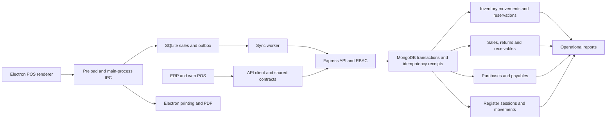

# ERP + POS audit and repair report

Latest final-release execution: [RELEASE-CLOSURE.md](RELEASE-CLOSURE.md), with new source changes, bounded actual results, storage limitation and prioritized gates. Current frontend168/desktop246completed; current backend full run incomplete from disk exhaustion. The739combined result below is the previous baseline, not qualification of every new change. **NOT READY**.

Current consolidated closure status: [FINAL.md](FINAL.md). Latest complete full suites:739passing executions (backend332/frontend168/desktop239). Actual two-terminal/Electron/native/IPC/PDF acceptance passed in the bounded scenarios. **NOT READY** remains the release recommendation. Older results below are preserved evidence.

Audit date: **2026-10-12, Africa/Cairo**. Scope: the existing working tree at `C:\Users\jeepc\Desktop\moto`, including the user's ongoing three-project reorganization. This is a completed, bounded audit pass with a persistent backlog, not certification that every screen, API or business rule has been tested.

## A. Executive Summary

**Release recommendation: NOT READY.** Current continuation details: [PASS3.md](PASS3.md), building on [PASS2.md](PASS2.md). Tested IPC sender/frame, session/permission/schema, navigation and customer-display disclosure paths are repaired. Renderer sessions no longer expose access/refresh tokens. Vitest 5.0.3, Vite 7.3.7, electron-vite 5.0.0 and compatible React/esbuild tools remove all critical development dependency paths. Electron 44.7.0 and better-sqlite3 13.0.3 remain the shipped runtime.

Latest complete suites: **719 passing executions** (backend 297+shared23; frontend 39+client5+POS100+shared23; desktop 104+client5+POS100+shared23), zero failures/skips in final runners. Shared copies are executions, not unique business scenarios. All three projects passed typecheck, lint and build after the toolchain upgrade; shared source parity passed. Targeted repeats and Electron scenario checks are excluded. Previous707 and675 results remain preserved evidence.

Actual Electron tests reproduced the original customer-display token leak with synthetic credentials, then passed seven IPC checks using the production boundary/preload/data-dispatch code with synthetic callbacks. Native SQL/encryption/auth/PDF checks and production-renderer mock-IPC checkout/printing/retry/cancellation acceptance passed; six new real PDFs and no physical print. The rebuilt Windows unpacked executable passed isolated-profile SQLite smoke. Authenticode reports **NotSigned**; installed NSIS/portable and signed download/update behavior remain unverified.

Current dependency scans: backend full0; frontend full8 (5high/3moderate); desktop full16 (5high/11moderate); no critical advisories and all production-only scans0. Electron was checked separately because its executable ships from a development dependency. Remaining Tailwind/build dependency paths are documented with a compatible follow-up plan; ASAR checks found none of the inspected development tools shipped.

Prior two-terminal file-backed SQLite/API acceptance and synthetic BSON/SQLite restoration evidence are retained. User-approved explicit refund method, company-wide supplier-number uniqueness and proportional purchase-return discount rules remain in effect. No existing business database mutation, production deployment, real payment, destructive migration, financial-history rewrite or user-process termination occurred. Current reorganization and earlier evidence were preserved.

Release blockers remain explicit reimbursement/immutable reversal/rejected cash settlement and representative historical reconciliation; offline auth/lock/revocation and remaining IPC policy acceptance; residual development advisories; authenticated deployment/backup acceptance; signed installer/update distribution; accounting scope and physical/provider/endurance acceptance. See [latest verification](evidence/verification-summary.json), [detailed continuation](PASS3.md) and [persistent checklist](CHECKLIST.md).

## B. System Inventory

### Architecture and dependencies

| Layer | Implementation | Entry points / dependencies |
|---|---|---|
| API | TypeScript, Express 5, Mongoose 8, MongoDB replica set | `erp-backend/src/server.ts`, `src/app.ts`; `/api`; JWT, bcrypt, Zod, transaction/idempotency middleware |
| ERP and web POS | React, Vite, TypeScript, React Query, Zustand, Arabic/English | `erp-frontend/src/main.tsx`, `src/router.tsx`; API services; shared POS components |
| Desktop POS | Electron 44.7.0, React, better-sqlite3 13.0.3, SQLite WAL, persistent outbox | `pos-desktop/src/main/index.ts`, preload IPC, renderer; local operations and sync worker |
| Shared contracts | Physical copies of `shared`, `api-client`, `pos-core`, `ui` | Per-project npm workspaces; `scripts/sync-packages.mjs --check` verifies parity |
| Realtime / jobs | Socket.IO; node-cron alerts and dead-stock snapshots | API server / `src/jobs/index.ts`; jobs are disabled by the isolated test environment |
| Files / exports | Public logo uploads; receipt HTML/PDF, XLSX export, QR/barcode | Settings, print profiles, labels, Electron printing; OS printer integrations |
| Delivery / deployment | API Dockerfile, Compose Mongo replica set; Vite build/Firebase config; electron-builder | Three independent installs/locks; root scripts orchestrate checks |
| External communication | WhatsApp web link or Meta Cloud mode; desktop updater | Mock/provider failure tests only; real delivery and update distribution unverified |

Changing shared refund arithmetic affects both clients and API. Stock guards affect sales, transfers and purchase returns. Payment/allocation changes affect customer/supplier balances, statements, register totals and reporting. Sync changes affect durable receipts, stock projections and restart recovery. A passing API test alone cannot establish desktop/backend integration.

### Modules and observed implementation status

| Module | Observed scope | Verification / missing scope |
|---|---|---|
| Organization / access | Users, roles, permissions, branches, warehouses, terminals | Direct API permission/branch tests; browser cashier restriction; incomplete IPC/customer/supplier sharing checks |
| Catalog / pricing | Products, categories, brands, motorcycle compatibility, tier/special pricing, barcodes, shelf/bin locations, quick items | Existing unit/integration tests and browser route renders; all bulk/CRUD combinations unexecuted |
| Sales / POS | Cash, split tender, credit, held sales, discounts, configurable tax, invoices, cancellation, returns | API regressions, inventory/financial/concurrency tests, browser cash checkout; no separate quotation/order/backorder workflow discovered |
| Purchasing | Orders, partial receipts, supplier invoice number, returns, allocations and balances | Purchase/stock/payable integration checks; no requisition workflow or duplicate supplier-invoice constraint |
| Inventory | Multi-warehouse stock, adjustments, counts, transfers, movement history, reservations, minimum stock | Movement reconciliation and concurrent stock tests; lots, serials and expiry tracking not discovered |
| Cash / expenses | Register opening/closing, deposits/withdrawals, refunds, receipts, expenses and discrepancy | API reconciliation and concurrent movement tests; SQLite restart tests; no physical drawer test |
| CRM / receivables | Customer records, credit limits, debt allocation, statements, special prices | Debt/balance tests; statement initial tender and sharing policies remain open |
| Finance / reports | Operational sales, tax, margin, inventory valuation, receivables/payables, dashboard and accounting summaries | Synthetic source-total comparisons; no chart of accounts, journals, trial balance or fiscal close |
| Alerts / audit | Stock/debt/anomaly alerts, notifications, audit log, dead-stock snapshots | Existing tests; live cron scheduling/recovery and full logging completeness unverified |
| Settings / documents | Company settings, logos, invoice configuration, print profiles, label designer, invoice verification | Upload security regressions, shared print tests, route smoke checks and PDF artifacts |
| Offline POS | Local checkout/returns/customer receipts/register operations, snapshots, outbox, retry/rejection, stable invoice numbers | Real SQLite tests and file restart scenarios, mocked API sync; real multi-terminal reconciliation incomplete |
| Payment processing | Records cash/card/bank-transfer/credit tender | No acquiring-provider integration or webhook implementation discovered; recorded card tender is not a verified charge |
| HR / payroll | Not discovered | Unimplemented; no payroll tests claimed |
| Loyalty / coupons / exchange workflow | Not discovered as dedicated modules | Do not treat ordinary discounts/returns as these modules |
| Imports | Bulk product updates and exports exist | No general product/customer/supplier file-import workflow discovered; complete import acceptance scenario unavailable |

MongoDB uses string IDs and application-enforced relationships, not foreign keys. Unique invoice/barcode/stock indexes exist; many embedded fields use `Mixed` and money uses JavaScript numbers/SQLite `REAL`. Synthetic referential checks pass, but these do not establish historical production-data integrity.

## C. Test Results

**Current continuation totals supersede the first-pass table below:**719 passing executions; current per-runner evidence is [PASS3.md](PASS3.md#executed-verification) and [pass3 summary](evidence/pass3/verification-summary.json). The following table preserves the first pass (675).

### Completed automated suites

| Runner group | Baseline cases | Final passed | Failed | Skipped |
|---|---:|---:|---:|---:|
| Backend main: unit + Mongo/API integration | 243 | 272 | 0 | 0 |
| Backend shared copy | 23 | 23 | 0 | 0 |
| Frontend main: component/unit | 38 | 39 | 0 | 0 |
| Frontend API-client copy | 4 | 5 | 0 | 0 |
| Frontend POS-core copy | 98 | 100 | 0 | 0 |
| Frontend shared copy | 23 | 23 | 0 | 0 |
| Desktop main: SQLite/auth/sync/printing unit/integration | 74 | 85 | 0 | 0 |
| Desktop API-client copy | 4 | 5 | 0 | 0 |
| Desktop POS-core copy | 98 | 100 | 0 | 0 |
| Desktop shared copy | 23 | 23 | 0 | 0 |
| **Executions** | **628** | **675** | **0** | **0** |

The main suites mix test categories; no fabricated separate unit/security/integration totals are assigned. Security and financial regressions are included in these totals. There is no assertion count. Repeated targeted/baseline reruns are excluded from the final 675. Existing React QR tests emit `act()` warnings; assertions pass, but test-harness warning debt remains.

An attempted broad verification run passed the backend but failed two frontend suites during module collection with `[vitest-worker] Timeout calling fetch`. No application assertions failed in those suites. The attempt is preserved in [interrupted verification](evidence/interrupted-verification.log). After stopping disposable browser services, frontend and desktop main suites were rerun with `--maxWorkers=1 --minWorkers=1`, without changing assertions or increasing timeouts. Final totals combine those completed project runners and their shared-package runners with the completed backend run; they are not a claim that the interrupted root command passed. Test-runner/environment instability remains a reliability follow-up.

Evidence: [baseline tests](evidence/baseline-tests.log), [final tests](evidence/final-tests.log), [machine-readable summary](evidence/verification-summary.json). Newly added tests include backend `audit-regressions.test.ts` (23), backend `uploads.test.ts` (6), desktop `sessionProjection.test.ts` (6), desktop authentication additions, supplier-payment UI retry and mirrored payment-dialog/API-client cases.

| Category | Executed result | Evidence / limits |
|---|---|---|
| Static compilation/types | Three projects passed, exit 0 | [typecheck](evidence/final-typecheck.log) |
| Lint | Three projects passed, exit 0, configured zero warnings | [lint](evidence/final-lint.log); no exhaustive dead-code/circular-import or formatting audit |
| Builds | API/web and desktop passed, exit 0 | [API/web build](evidence/final-build.log), [desktop build](evidence/desktop-build.log) |
| Shared parity | Passed | [parity](evidence/package-parity.log) |
| Browser smoke/UI | 35 passed: 30 routes plus redirect/login, validation, LTR/mobile, permission checks | [results](evidence/browser-results.json); Chromium only; route renders are not full CRUD coverage |
| Browser workflow | 2 checks passed in one checkout journey | [checkout](evidence/browser-checkout.json); scan/search → cash sale → saved API invoice |
| Electron workflow | 1 scenario passed; 6 synthetic sale creations, 5 one-page PDFs | [verification](../pos-desktop/release/verification/results.json), [log](evidence/electron-verification.log); real Electron renderer/PDF, mock IPC, simulated printer failure/retry |
| Performance | 400 read requests passed, concurrency 5; 0 errors | [measurements](../erp-backend/audit/evidence/performance.json); four endpoint workloads, 100 requests each |
| Dependency security | 3 full scans and 3 omit-dev scans completed | JSON below; advisories remain; scanning is not exploit validation |
| Compose syntax | Validated with `.env.example` and synthetic values | [log](evidence/compose-validation.log) is empty because `config --quiet` succeeded |
| Database integrity/concurrency | Existing isolated API/replica-set and real SQLite cases passed | Source-record reconciliation, bounded concurrent sales/transfers/money operations; no existing database inspected or changed |
| Migration/bootstrap | Bootstrap/connect and local SQLite restart checks pass | Missing price migration remains; no production migration or backup restore executed |

Code coverage was **not measured**. There is no installed coverage-provider workflow in these projects. Passing cases cannot establish line/branch coverage or all business scenarios. Broader load/endurance/large-catalog tests, actual peripherals, full accessibility, Firefox/WebKit, full API contract enumeration, real provider sandboxes and release deployment are **unexecuted**. Counts for these undefined scenarios are not invented.

### Required cross-module scenarios

| User scenario | Status and actual evidence |
|---|---|
| 1. Purchase → inventory → payable/payment | Exercised through API by `integrity.test.ts`; synthetic stock/supplier reconciliations pass. Journal posting unavailable |
| 2. POS cash sale | Browser checkout saved a real API invoice; API integrity tests independently cover stock/register effects; Electron receipt scenario uses mock IPC |
| 3. Split payment | API cash-change/register test and overpayment regressions pass; no provider approvals involved |
| 4. Credit sale and later receipt | API integrity/receivable cases pass; cashier credit behavior preserved; statement/prepayment policies incomplete |
| 5. Return/refund | Quantity, cumulative rounding, stock and refund-date reporting tests pass; no acquiring-provider refund or posted journal reversal |
| 6. Failed payment recovery | Same-key supplier retries and UI lost-response/auth retry tested; checkout/withdrawal durable receipts tested; provider timeout scenario unavailable |
| 7. Concurrent stock sales | Five racing sales against limited stock and two competing transfer approvals tested; offline multi-device oversell reconciliation incomplete |
| 8. Multi-branch isolation | Several direct API tests pass; repaired financial endpoints covered; remaining record/sync catalog exposure means whole-system isolation is partial |
| 9. Daily closing | API repeated close/concurrent cash cases and local SQLite close/restart tests pass; real cashier/hardware acceptance unexecuted |
| 10. Period-end reconciliation | Operational report/refund-period tests pass; general-ledger/fiscal-close scenario unavailable |
| 11. Permission enforcement | API tests plus browser cashier settings denial pass; comprehensive main-process IPC matrix unexecuted |
| 12. Imports and duplicates | Invoice/idempotency/catalog validation subsets tested; general file-import scenario unavailable |

## D. Defect Register

Priorities follow the requested P0–P3 scale. Fixed findings below describe synthetic reproduction, expected behavior and observed pre-fix failure. Source-only findings are explicitly marked; they are risks requiring follow-up, not claims that an exploit was executed. No existing financial history was retroactively repaired.

### Repaired findings

| ID / priority | Module; reproduction and actual → expected | Root cause / affected files | Repair, regression and verification | Remaining risk |
|---|---|---|---|---|
| F01 / P0 | Sale of 100 paid by card 150 was accepted; credit excess discarded → reject unallocatable excess; cash-covered split change allowed | `sales/service.ts`, desktop `sync/localOps.ts`, payment dialog: payment clamp lacked tender validation | Fixed API/local/UI checks; audit, SQLite integrity and mirrored UI regressions pass | Tender recording does not process external payments |
| F02 / P1 | Submit known inactive product ID → reject before stock/sale write | Sale service checked existence only | Active/deleted checks; audit regression passes | Other catalog lifecycle/IPC paths need matrix review |
| F03 / P0 | Create sale with status `returned` to persist an invoice outside normal posting → reject | Sale create trusted client lifecycle state | Only `completed`/`held` allowed; audit regression passes | Full state-machine/fiscal-history audit remains |
| F04 / P0 | Return invoice, then cancel it → previously refund cash again; reject cancellation once returns exist | Cancellation did not account for prior returns | Return-document/item guards; drawer unchanged in audit regression | Cancellation payment-history issue O03 remains |
| F05 / P0 | Three one-unit returns of a 0.14 discounted invoice previously refunded 0.15 → cumulative maximum 0.14 | Independently rounded unit refunds; returnedQty advanced before calculation | Shared cumulative rounding; backend cumulative cap; local order corrected; API regression/shared consumers pass | Offline cross-line total cap/history O07 remains |
| F06 / P0 | Concurrent retries of same supplier payment → previously could post multiple allocations | Missing endpoint idempotency/client key persistence | Existing transactional middleware plus optional client key; API same-key, client auth retry and UI lost-response regressions pass | Closing/reopening dialog or editing payload may create a new intent/key; operator reconciliation needed |
| F07 / P0 | Pay unknown supplier, excessive balance or explicit foreign purchase → previously orphan/excess/cross-branch risk | Payment allocation omitted validation and branch scope | Supplier/tender/payable/status checks, scoped automatic allocation; audit regressions pass | Supplier-credit allocation/prepayments require policy |
| F08 / P0 | Read another branch's supplier payment list or customer financial statement/summary → deny/filter | Financial routes omitted server-side branch guard | Purchase lists scoped via purchase IDs; customer financial reads guarded; audit regressions pass | Return-list filtering implemented; the list regression directly asserts payment exclusion only. O01 broader sharing remains |
| F09 / P0 | Reserve 1 of 1 units then sell it → previously consumed reserved stock | Atomic stock guard used on-hand instead of available | Guard uses quantity minus reserved; audit rejection and existing stock tests pass | Existing historical invalid reservations not reconciled |
| F10 / P0 | Approve two competing transfers of 2 from available 2 → previously over-reserved | Reservation increment lacked atomic availability predicate | Guarded reservation, one approval succeeds and one rejects; audit regression passes | Extensive offline/interleaved warehouse schedules unexecuted |
| F11 / P0 | Create negative/overpaid purchase or unknown supplier/product → reject before record/stock posting | Purchase create lacked semantic checks | Supplier/product/total/payment validation; audit regression passes | Duplicate supplier invoice policy O04 remains |
| F12 / P0 | Cancel foreign-branch purchase or cancel a paid unreceived invoice → previously allowed unsafe state/balance change | Missing branch guard, standalone writes and no paid cancellation policy | Transaction, branch guard, audit, paid-invoice rejection | Foreign cancellation regression passes; paid guard inspected, lacks dedicated new regression; reconciliation workflow absent |
| F13 / P0 | Duplicate return rows exceed net received quantity; forge unitCost 50000 → reject excess and use stored cost 50 | Prior returns counted without accumulating current rows; trusted submitted cost | Accumulated quantities/stored costs; regression checks stock unchanged on rejection and result 50 | Discount/paid supplier credit policy O05 remains |
| F14 / P1 | Branch dashboard/accounting payables returned global supplier balance → branch purchase balance | Global supplier query in branch reports | Aggregate branch purchases; independent branch expected sum checked by audit regression | All-branch and legacy supplier balances need historical reconciliation |
| F15 / P2 | Send malformed JSON → previously 500; expected 400 `INVALID_JSON` | Missing parser-error classification | Error handler updated; audit regression passes | Complete status/error contract enumeration unexecuted |
| F16 / P0 | OS encryption unavailable → session token stored as readable base64 | Desktop fallback pretended encoding was encryption | No token/profile/password cache without OS encryption; invalid caches discarded; four auth cases pass | Offline credentials/revocation policies and full IPC authorization unverified |
| F17 / P1 | Logo HTML submitted as PNG/name.html, type mismatch, active SVG, oversized upload → accepted or 500 | Trusted MIME/original extension; Multer errors unclassified | Memory limit, signature/MIME match, UUID/canonical extension, raster allowlist, client errors; six upload regressions pass | Signature checks are not full image decode/re-encode; legacy uploads untouched; CSP already limits active content |
| F18 / P0 | 5001 shift sales counted only 5000; card/transfer totals stayed zero; unpair wiped unresolved outbox → correct totals and prevent erase | Bounded recent-sale list; omitted buckets; db.wipe lacked invariant | Session query/all tender buckets; transactional wipe guard with early pair/unpair checks; six SQLite regressions and restart suites pass | Session query scans cached JSON; full Electron IPC lifecycle/concurrent pairing acceptance unexecuted |
| F19 / P0 | Supplier summary/statement/debt overview exposed other-branch purchases → filter financial records | Queries used supplier ID without branch/purchase scope | Summary/statement payment/return joins and branch debt balances; two audit regressions pass; overview rounded to cents | Shared supplier catalog/list/get still exposes global balance, O01 |

Reproduction logs are retained under `audit/evidence/reproduced-*.log`; intentional pre-fix failures are **not** current failing suites. Relevant successful logs: [API regressions](../erp-backend/audit/evidence/final-api-regressions.log), [uploads](../erp-backend/audit/evidence/upload-regressions.log), [supplier financial reads](../erp-backend/audit/evidence/supplier-statements-regressions.log), [SQLite](evidence/session-regressions.log), [UI retry](evidence/supplier-payment-ui.log), [payment dialog](evidence/repaired-payment-ui.log), [desktop auth](evidence/desktop-regressions-final.log). The final suite is authoritative for current case counts.

### Unresolved defects, policy questions and verification risks

| ID / priority | Evidence and affected component | Reproduction / expected versus actual | Root cause, status, required repair and regression |
|---|---|---|---|
| O01 / P0 | Final closure: [FINAL.md](FINAL.md) | Current execution evidence in evidence/final | Bounded API/IPC branch projections retained; current socket admission loads current branch/role/version. Full regressions pass; connected-session/historical matrix remains. See FINAL.md. |
| O02 / P1 | Final closure: [FINAL.md](FINAL.md) | Current execution evidence in evidence/final | Ledger/COA/journals/fiscal-close scope unresolved. See FINAL.md. |
| O03 / P0 | Final closure: [FINAL.md](FINAL.md) | Current execution evidence in evidence/final | Explicit paid cancellation uses immutable return and debt-first payout; original receipts retained; regressions pass. Paid-unreceived purchase/unpaid legacy debt deletion/historical reconciliation remain. See FINAL.md. |
| O04 / P1 | Final closure: [FINAL.md](FINAL.md) | Current execution evidence in evidence/final | Company-wide supplier invoice guard retained; historical uniqueness constraint unapplied pending representative review. See FINAL.md. |
| O05 / P0 | Final closure: [FINAL.md](FINAL.md) | Current execution evidence in evidence/final | Mixed customer/supplier debt-first refunds and exact discounted purchase-line returns pass; supplier treasury/provider/historical acceptance remains. See FINAL.md. |
| O06 / P1 | Final closure: [FINAL.md](FINAL.md) | Current execution evidence in evidence/final | Initial-payment absence disproved; tender/allocation/statement tests retained. Historical null allocations/prepayments remain. See FINAL.md. |
| O07 / P1 | Final closure: [FINAL.md](FINAL.md) | Current execution evidence in evidence/final | SQLite5 durable refund/settlement history and restart/backup regressions pass; backdated delta and rejected-return workflow remains. See FINAL.md. |
| O08 / P1 | Final closure: [FINAL.md](FINAL.md) | Current execution evidence in evidence/final | Real two-terminal acceptance passed again; collected rejected tender retained until explicit same-method payout; source/stock/debt/restart tests pass. Split/cross-method/archival/server-close acceptance remains. See FINAL.md. |
| O09 / P1 | Final closure: [FINAL.md](FINAL.md) | Current execution evidence in evidence/final | Actual IPC7/native/renderer/PDF passed; main auth lock added. Independent idle/provisioning/print-resource/unpair/update acceptance remains. See FINAL.md. |
| O10 / P1 | Final closure: [FINAL.md](FINAL.md) | Current execution evidence in evidence/final | Atomic refresh/password-version/expired or revoked-access logout repaired; current socket admission and desktop24h/lock/single-flight/revoked cache regressions pass. Already-connected sockets/restart/provisioning remain. See FINAL.md. |
| O11 / P2 | Final closure: [FINAL.md](FINAL.md) | Current execution evidence in evidence/final | Cairo DST-aware ranges/grouping/cron/sales stats and invalid/reversed API cases pass. Live jobs/comparative/calendar acceptance remains limited. See FINAL.md. |
| O12 / P1 | Final closure: [FINAL.md](FINAL.md) | Current execution evidence in evidence/final | Electron44.7.0/native SQLite qualified; scans backend0/frontend8/desktop16; critical0/omit-dev0. Residual build advisories and signed distribution remain. See FINAL.md. |
| O13 / P1 | Final closure: [FINAL.md](FINAL.md) | Current execution evidence in evidence/final | Final unpacked package-qualified smoke passed; NotSigned. Docker unavailable; authenticated release/signed install/update acceptance remains. See FINAL.md. |
| O14 / P2 | Final closure: [FINAL.md](FINAL.md) | Current execution evidence in evidence/final | Read-only price plan/disposable tests retained; representative migration/backup/approval/apply/rollback remains. See FINAL.md. |
| O15 / P2 | Final closure: [FINAL.md](FINAL.md) | Current execution evidence in evidence/final | Prior read workloads and passing builds retained; no SLA/endurance/large-catalog certification. See FINAL.md. |
| O16 / P3 | Final closure: [FINAL.md](FINAL.md) | Current execution evidence in evidence/final | No act warning in latest logs; original warning debt preserved, no suppression or independent root-cause repair claimed. See FINAL.md. |
| O17 / P1 | Final closure: [FINAL.md](FINAL.md) | Current execution evidence in evidence/final | Synthetic BSON/SQLite5 restoration passes; representative history/production-format backup/PITR/RPO/RTO unavailable. See FINAL.md. |
| O18 / P2 | Final closure: [FINAL.md](FINAL.md) | Current execution evidence in evidence/final | Physical/provider/accessibility/CRUD/endurance acceptance remains unexecuted; full-disk failures preserved and available-space reruns completed. See FINAL.md. |

## E. Code Changes

Changes are incremental within the existing architecture. [Changed-file hashes](evidence/changed-files.json) and [snapshot comparison patch](evidence/audit-changes.patch) compare preserved pre-audit files because the reorganized projects are largely untracked and a normal Git diff would omit their edits. [Original Git status](evidence/baseline-git-status.txt) preserves the starting state. No files were staged.

| Area | Significant modifications / impact |
|---|---|
| Sales service | Tender validation, active-product checks, allowed create states, cancellation-after-return protection, refund cap/cumulative calculation order. Some formerly accepted invalid requests now return client errors |
| Shared refund helper | Cumulative rounding using optional returnedQty; all three shared copies synchronized. Existing callers without returnedQty remain supported |
| Purchasing routes | Retry receipts, safe allocation, branch filters, valid purchase references/amounts, stored return cost, transactional cancellation and supplier financial reads. Paid cancellation requires reconciliation |
| Inventory service/routes | Atomic available-stock/reservation predicates; rejects consuming reserved stock or competing over-reservations |
| Customer/report routes | Financial branch guards and branch-specific payables; no historical balances rewritten |
| Error handling/settings | Malformed JSON and Multer client errors; safe raster logo naming/signatures. New SVG uploads rejected; existing files preserved |
| Web POS/payment UI | Mirrors tender/customer requirements; Arabic/English overpayment message; retry keeps supplier dialog open and reuses matching request key |
| API-client copies | Optional supplier payment idempotency key, retained through authentication retry |
| Desktop auth | Removes readable cache fallback; encryption-unavailable online session stays in memory; invalid caches discarded |
| Desktop database/local operations/main | All-session projection, electronic buckets, cumulative line rounding, atomic wipe guard and early pairing checks; existing DB schema unchanged |
| Documentation/evidence | Backend logo rules, desktop credential/wipe/shift behavior; audit scripts, regressions, checklist/report and synthetic outputs |

No major dependency version was changed. No migration/index was applied to an existing database. Remaining policies are documented rather than silently invented. Cashier credit sales remain permitted under the established `sales.create` policy; no new `customers.credit` requirement was imposed on checkout.

## F. Business Integrity

| Invariant | Evidence-based status |
|---|---|
| Sales total and tender | API tests independently recompute line/subtotal/tax/discount totals, check overpayment/underpayment and split cash change. **Verified for exercised synthetic cases**; no provider settlement |
| Inventory opening + movements = closing | `integrity.test.ts` snapshots stock then sums new signed movements through sale, return, purchase receipt/return, adjustment and transfer. **Verified for exercised scenario**; historical data untouched |
| Reservations and no oversell | Last-stock concurrent sales, reserved checkout rejection and competing approvals passed. **Bounded online concurrency verified**, offline multi-device unresolved |
| Cash expected balance | Opening + cash sales + receipts − withdrawals − expenses − refunds recomputed; movement/source-sale reconciliation passed. SQLite shift/restart cases pass. **Operational synthetic reconciliation verified**, no physical cash count |
| Customer/supplier balances | Debt totals and purchase remaining independently compared in integrity tests; branch payables corrected. **Fixture cases pass**; statement initial paid/cancellation/credits not fully reconciled |
| Debit = credit | **Unavailable**: no posted journal/general ledger module. Operational report totals are not a ledger balance test |
| Financial reports reconcile | Grouped sales/dashboard/accounting and refund-date revenue/tax/cost tests pass. **Operational subset verified**; period-end statements and full financial close unavailable |
| Duplicate transactions | Durable same-key sale/withdrawal/supplier payment and same-op sync tests pass. **Specified retry paths verified**; duplicate supplier invoices and new-intent retries remain risks |
| Multi-branch isolation | Repaired direct API paths pass; whole-system assertion **not verified** because O01/O09 remain |
| Audit history | Existing audit events and transactional cancellation writes inspected. **Not globally verified**; sale cancellation deletion O03 remains |

One existing integrity assertion labelled `paid + remaining` tests only overstatement, not equality after every return. Customer balance checks also omit some pre-credit cases. Those passing tests therefore do not establish every stated financial invariant; the report does not upgrade their guarantees.

## G. Security and Performance

### Security results

Executed negative/security cases include unauthorized financial actions, foreign branches/registers/returns/debt allocations, forged lifecycle/product/cost inputs, malformed JSON, unsafe uploads, cache encryption failure and duplicate financial requests. Existing JWT/RBAC, bcrypt, httpOnly web refresh cookies, security headers/CSP, production environment checks, cost projection and request logging redaction were inspected and existing tests passed. The isolated test mode disables global rate limits and jobs; production rate-limit behavior and live scheduling were not verified by browser/performance results.

| Scan | Critical | High | Moderate | Total vulnerable package entries |
|---|---:|---:|---:|---:|
| Backend full tree | 2 | 1 | 3 | 6 |
| Frontend full tree | 2 | 6 | 6 | 14 |
| Desktop full tree | 3 | 19 | 11 | 33 |

These are scanner package entries, not independent exploits; transitive entries can reflect the same advisory. Evidence: [backend](../erp-backend/audit/evidence/backend-dependencies.json), [frontend](evidence/frontend-dependencies.json), [desktop](evidence/desktop-dependencies.json). Counts reflect the scan date and installed locks.

All three `--omit=dev` scans report zero: [backend](../erp-backend/audit/evidence/backend-runtime-dependencies.json), [frontend](evidence/frontend-runtime-dependencies.json), [desktop](evidence/desktop-runtime-dependencies.json). **That does not make desktop runtime clean**: Electron is a packaging devDependency but its binary ships to users. Full scans include high Electron advisories and critical Vitest/tinypool/tar paths. Not every advisory applies to enabled app features or Windows, but shipped-runtime exposure requires version/platform triage. A major upgrade/native ABI migration was deliberately left as a controlled release task.

Uploads are now limited to raster signatures and canonical image extensions; this prevents the reproduced arbitrary extension/MIME behavior. It is not an image decoder, content sanitizer or legacy-file cleanup. Existing API CSP helps contain active document content, and no claim of executed XSS was made. OWASP categories were risk-reviewed through source/negative tests; comprehensive CSRF/SSRF/injection/fuzz/security penetration coverage was not completed.

### Measured performance

Environment: Windows, Node 22.17.0, i7-13650HX, 15.7 GiB, loopback development API, disposable single-node MongoMemoryReplSet with a small synthetic catalog. Each endpoint received 100 requests at concurrency 5. Includes authentication/database overhead; rate limits disabled. These measurements do not establish production capacity, checkout latency, database-only time or a release SLA.

| Workload | p50 ms | p95 ms | p99 ms | Requests/s | Errors |
|---|---:|---:|---:|---:|---:|
| SKU lookup | 16.21 | 21.58 | 22.46 | 280.19 | 0/100 |
| Actual barcode lookup | 14.99 | 17.83 | 19.36 | 307.37 | 0/100 |
| Accounting summary, 2020–2030 | 103.50 | 130.06 | 147.56 | 44.63 | 0/100 |
| Product list, page size 100 | 32.09 | 42.69 | 45.54 | 140.56 | 0/100 |

Evidence: [performance JSON](../erp-backend/audit/evidence/performance.json). No optimization was justified solely by these small read workloads. Memory/CPU endurance, pool saturation, checkout throughput, report query plans and large-catalog screen latency remain unmeasured. Web main chunk and desktop renderer sizes generate performance follow-up; build success does not resolve that risk.

## H. Remaining Work

Prioritized current release conditions are recorded in [FINAL.md](FINAL.md): financial treasury/historical allocations and settlement archival; connected-session/provisioning/print acceptance; residual build advisories and signed installation/update; authenticated deployment/production backup/PITR; accounting scope and physical/provider/endurance targets. No further numbered audit phase is proposed.

## I. Final Release Recommendation

**NOT READY.** Latest complete runners:739passing executions (backend332/frontend168/desktop239), with zero failed/skipped cases in those runners. Available two-terminal, Electron/native/IPC/PDF and isolated unpacked smoke passed. The remaining conditions in FINAL.md prevent production certification. Historical results earlier in this report remain preserved evidence.
